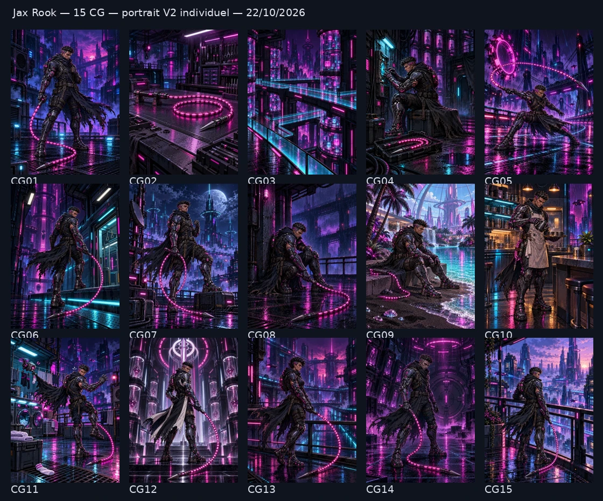

# Jax Rook — quinze CG et atlas V2, 22 octobre 2026

Quinze CG originales ont été générées puis acceptées après revue indépendante. Chaque créneau possède une composition et un décor propres dans Neon Requiem. Les fichiers sont prêts pour l’intégration au registre par le coordinateur.

Le [portrait individuel V2 actuellement sélectionné](../../references/wave5-2026-10-22/jax-rook/canonical-selected-portrait-v2.png) fait autorité pour cette création originale du projet. Il montre l’exosquelette graphite et acier, les inserts magenta, les cheveux noirs hérissés, l’implant à la tempe, la cape noire déchirée et le monofilament segmenté à pointe métallique. L’ancien atlas à doublure jaune est conservé pour comparaison historique ; il n’établit pas l’identité V2.

Les [références et limites](../../jax-rook-reference-evidence-wave5-2026-10-22.json), le [plan des quinze créneaux](../../jax-rook-wave5-plan-2026-10-22.json), le [reçu des 45 médias](../../jax-rook-wave5-2026-10-22.json) et la [revue indépendante des CG](jax-rook-independent-review.json) permettent de contrôler les sources et les choix.

Les créneaux CG01–08 couvrent la référence, le monofilament seul, le décor seul, une intervention au refuge, l’action Nexus, l’arrivée, la victoire et le repli. Les thèmes spéciaux restent explicites : plage artificielle familiale (09), service à la cantine (10), drone de lessive comique (11), collecteur Helix Crown d’alignement inversé (12), Jaxa en gender swap sans costume croisé (13), corruption mnésique zombie non graphique (14) et futur expérimenté (15). CG09–11 sont du Fan Art ; CG12–15 sont des What If.

La série comporte dix-huit sorties ImageGen réussies : quinze sélections et trois essais conservés. La correction du décor a supprimé les silhouettes ambiguës en passant à une architecture vide, avec garde-corps vitrés et archives géométriques. La correction de CG04 rend la poignée cylindrique émoussée clairement distincte de l’unique pointe métallique. Les quinze PNG sources conservent exactement les pixels RGB natifs, sans recadrage ni conditionnement de ratio ; chaque fichier est au ratio 3:4. Les masters sont en 1536 × 2048 et les miniatures en 384 × 512.

L’[atlas corrigé](../../../audits/jax-rook-v2-reference-sprite-fidelity-wave5-2026-10-22.json) contient seize poses revues [indépendamment](jax-rook-sprite-independent-review.json). Une vraie génération de l’atlas et trois nouveaux dessins des poses 11, 13 et 15 corrigent le contrôle du monofilament par la main droite. Treize cellules restent identiques dans l’assemblage avant la dernière normalisation technique. La garde finale est de seize pixels et les seize lignes de pieds sont à 239. L’ancien atlas reste intact ; la [comparaison technique](../../screenshots/jax-rook-sprite-comparison-wave5-2026-10-22.webp) présente les deux versions et la source V2. Le [reçu d’atlas](../../jax-rook-sprite-wave5-2026-10-22.json) distingue l’installation du fichier de sa sélection dans le jeu.

Le portrait source montre surtout le dos de trois quarts. Les détails frontaux cachés, les iris et certains éléments mécaniques restent interprétés. Les décors sont des compositions nouvelles cohérentes avec l’univers. Les revues, dimensions et empreintes ne certifient aucune fidélité parfaite 1:1 automatiquement.
